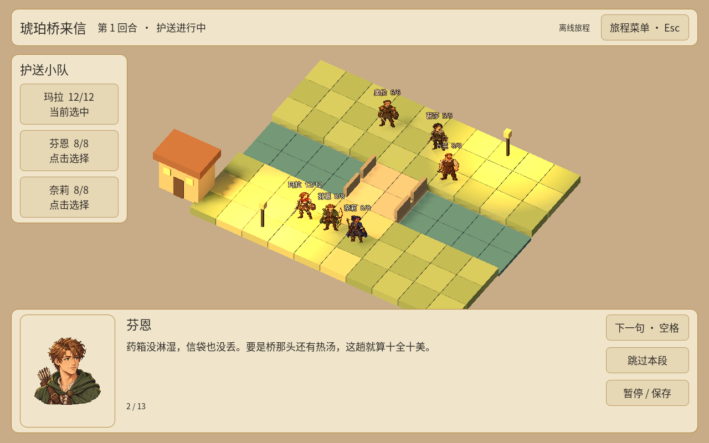

# Amber Bridge / 琥珀桥

一个小规模、暖色欧式幻想佣兵战棋原型：骑士、弓手、法师守住石桥。
角色使用原创候选像素素材，置于受实时光照的 3D 方格战场。中文菜单、剧情头像、存读档与数据型关卡工坊已接入。**这是持续开发的可玩原型，环境美术、完整技能/装备/AI 系统尚未完成。**



截图由 Godot 4.6.3 + OpenGL/Mesa llvmpipe 实际渲染；不是概念图。

## 架构

- **唯一规则**：`logic/battle.lua` 与固定 `logic/rules/*.lua` 模块。Lua 5.4.7、整数坐标/伤害/生命、显式 Park–Miller 随机状态、固定 BFS/单位遍历顺序。
- **桥接**：`native/extension.cpp` 的 `AmberLogic` 把有界字典/整数/布尔/字符串传入 Lua，返回值数据；规则不接触 Godot 对象、动画完成、时钟、文件或网络。
- **调度**：`logic/authority.gd` 给合法行动确定顺序。离线也走同一调度与规则。客户端不预测；收到权威命令后完整执行同一份 Lua。
- **一致性**：严格连续行动号、完整固定规则模块源码 SHA-256、规范数字快照 SHA-256、每条命令执行后校验。固定 16 条日志生成新检查点，重连取检查点 + 尾部命令并逐条执行。
- **网络**：`AmberTransport` 实际调用外部 **fsnet::Node** 的 RPC、连接与主线程 poll。不是模拟网络。首版只监听 `127.0.0.1`，两个本地客户端合作控制同一支队伍；先到的合法命令生效，过期命令被拒绝。
- **表现**：GDScript `main.gd` 只处理输入、模型/像素纹理、界面与状态显示。没有第二份战斗规则。地形查询用于展示，合法性最终由 Lua 决定。

这是一个独立的纯 Lua reducer 适配器，**没有复制 fsnet 的 entity.lua，也没有绑定其完整实体/预测 API**。目前复用的是 fsnet 传输；共享规则的服务端/客户端由本项目相同 Lua VM 适配器执行。

## 构建（已验证 Linux x86_64）

需要 Godot **4.6.3**、C++20 编译器、CMake >= 3.22、Ninja、Python 3、Git。
原生扩展不提交二进制；clone 后先构建，再在 Godot 导入 `project.godot`。

外部源目录：

1. 官方 [godot-cpp](https://github.com/godotengine/godot-cpp/tree/507ed9d840c01a3c5b2a39af8bb4000bfac30bf5)，标签 `10.0.0-stable`，提交 **507ed9d840c01a3c5b2a39af8bb4000bfac30bf5**。CMake 指定目标 API 4.6，启用 C++ 异常以在 ABI 边界捕获。
2. 官方 [Lua 5.4.7](https://github.com/lua/lua/tree/v5.4.7) 未修改源码。该 GitHub tag tarball SHA-256：`5c39111b3fc4c1c9e56671008955a1730f54a15b95e1f1bd0752b868b929d8e3`。
3. 外部 [fsnet](https://github.com/frodosens/fsnet) checkout 与已构建 `libfsnet.so`。公开基线 **8e4af0c9b73445d999a9e3593c1429c63bbec882**；按该仓库构建说明准备依赖。示例 `cmake -S /path/fsnet -B /path/fsnet/build -G Ninja -DCMAKE_BUILD_TYPE=Release -DBUILD_TESTING=OFF -DFSNET_WITH_LUA=OFF`，随后 `cmake --build /path/fsnet/build --target fsnet`。本项目自己嵌入同版 Lua，无需依赖 fsnet 的 Lua 私有符号。

```sh
export GODOT_CPP_DIR=/absolute/path/godot-cpp
export LUA_SOURCE_DIR=/absolute/path/lua
export FSNET_SOURCE_DIR=/absolute/path/fsnet
export FSNET_LIBRARY=/absolute/path/fsnet/build/libfsnet.so
./tools/build.sh
./tools/import.sh
./tools/test.sh
```

构建生成 `bin/libamber.so`，通过构建 RUNPATH 定位外部 libfsnet。移动外部库后请重新构建或设置 `LD_LIBRARY_PATH`。此处不提供未经验证的 Windows/macOS 包；对应平台需要分别编译并配置 `.gdextension`。

若运行环境 HOME 不可写，可将 `XDG_DATA_HOME`、`XDG_CONFIG_HOME`、`XDG_CACHE_HOME` 指向自己可写的临时目录。

## 玩一局

```sh
godot --path .
```

点我方角色选中，`1` 移动后点击高亮格；`2` 攻击后点击敌人；`3` 技能。
骑士技能点击自己恢复 3 HP；弓手技能增加射程与伤害；法师技能范围攻击。
每轮每人一次移动 + 一次行动，技能每场一次，伤害有显式固定 RNG 的 0/1 加成。
空格结束我方回合，敌方按确定性规则移动/攻击。击败所有敌人胜利，队伍全灭失败。`R` 重开离线局。

本地联机（同一机器三个终端，使用同一个临时 token）：

```sh
# 在三个终端各设置同一值；不要将实际 token 提交到 Git。
export AMBER_TOKEN='replace-with-a-local-random-secret-at-least-16-chars'
godot --headless --path . --script res://server.gd -- --port=27840
# 另外两个终端分别运行：
godot --path . -- --connect=27840
```

两客户端合作操作同一队伍。界面显示行动号和状态哈希。断线时不会盲目重发可能已执行的命令；重连后从服务器的快照和日志恢复，并以服务器确认的请求号继续。当前不支持服务器重启后续局：服务器内存状态丢失时，已有客户端拒绝向旧行动号倒退，应重新开局。联机 `R` 不会擅自重置全局战斗。

## 验证与边界

执行 `./tools/test.sh`：跨语言类型/错误/预算/生命周期；三 VM 完整胜负流程、非法/重复命令、快照/哈希；场景拾取输入；三个独立进程通过真实 fsnet RPC 同步并断线重连。
详见 [实际验证记录](docs/VALIDATION.md) 和 [架构边界](docs/ARCHITECTURE.md)。

没有公网、身份账户、房间服务、存档持久化、掉线托管、预测回滚或反作弊；token 仅用于受信任本机演示，不是玩家身份。没有移动端、Windows、macOS 或跨 CPU/编译器确定性验收。没有下载导出模板或生成独立可执行发行包。

## 来源与许可

保留仓库原有 MIT LICENSE。本项目新增代码与程序化占位图形使用该许可。
第三方源码/库不随仓库或项目 ZIP 分发：godot-cpp 与 Lua 为 MIT 类许可，详见各自上游；fsnet 在本次检查的公开基线未见顶层 LICENSE，因此仅作外部依赖引用，不复制或再分发其源码/二进制。实际产品分发前需由权利人明确许可。

## 当前增量与边界

主菜单提供新游戏、存档列表、网络房间与退出；局内暂停可保存/返回。存档绑定完整规则和内容哈希，包含随机状态、行动号和本地剧情阅读位置；旧规则存档明确拒绝，不静默迁移。网络房间目前仍限本机，在线本地存档禁用并提示。

关卡工坊可画地形/放置出生点，并用 JSON 编辑单位、剧情、目标和装备**定义**；校验后写入用户目录，支持重新加载和试玩。装备定义不等于装备系统：当前装备按钮禁用，尚无穿脱、随机掉落或道具使用。

基础友军/敌军 AI 已共用合法行动路径；控制器与阵营可分别配置。当前策略仍为最近目标追击，防守/支援/护送待实现。目标支持有界 all/any 组合与消灭、保护、到达、生存条件；同时触发时失败优先。

玛拉对奥伦的普攻可播放横向突刺演出，支持加速/跳过；仅消费已结算事件。8 张攻击关键帧 + 4 张防守关键帧组成 24 tick 时间线，**不是 24 张独立绘制帧**，其他职业尚未提供同等演出。

见 [增量验证与剩余工作](docs/UI_STORY_INCREMENT.md)、[战斗迁移边界](docs/BATTLE_ARCHITECTURE.md)。
